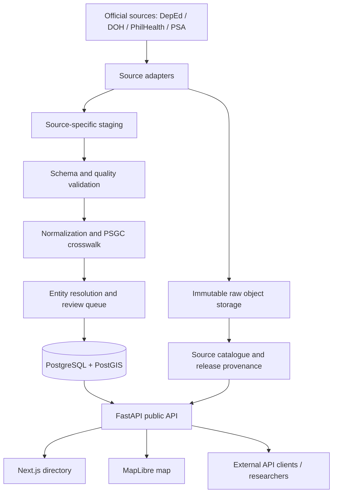

# 02 — Technical Architecture

## 1. Architecture decision

**Use one monorepo with independently deployable applications.** Keep the web application, public API, and ingestion workers in separate app boundaries. They share repository governance and API contracts, not one runtime or release process.

### Why monorepo

- API/schema and frontend changes can ship in one reviewed pull request.
- Contributors can fix a source adapter without cloning multiple repositories.
- Documentation, CI, fixtures, database migrations, and local development stay together.
- Generated API clients can be updated from the same OpenAPI specification.

### When to split later

Only consider extracting an app into a separate repository when it has independent maintainers, release cadence, governance, or consumers that make the split materially useful. Do not split merely because deployments are independent.

## 2. High-level system



## 3. Applications and responsibilities

### `apps/web`

- Next.js App Router, TypeScript, shadcn/ui, Tailwind CSS.
- Public directory, map, facility profiles, dataset/source catalogue, quality/status pages, API documentation entry point.
- Calls FastAPI through a generated TypeScript client.
- Does not connect directly to PostgreSQL or ingest source files.
- Uses server rendering for indexable directory/facility pages where appropriate; client components for interactive map/filter state.
- Serves the MapLibre GL JS v6 worker as a versioned static asset. `scripts/copy-maplibre-worker.mjs` runs on `predev`/`prebuild`, copies the installed worker to `public/vendor/maplibre-gl/<version>/`, and `src/lib/maplibre.ts` calls `setWorkerUrl()`; Next.js/Turbopack does not preserve MapLibre's sibling-worker URL.

### `apps/api`

- Python, FastAPI, Pydantic, SQLAlchemy 2, Alembic.
- Versioned, read-oriented public API.
- Performs filtering, pagination, spatial queries, source/provenance retrieval, history, and bulk-export discovery.
- Does not download or parse agency files in request handlers.
- OpenAPI is the contract for frontend client generation.

### `apps/ingest`

- Python source adapters and repeatable ETL jobs.
- Detects/downloads releases, stores exact raw files, parses, stages, validates, normalizes, matches, and publishes.
- Has source-specific dependencies and tests.
- Can run as a scheduled GitHub Actions job or a scheduled container initially.
- Does not serve user traffic.

### `packages/api-client`

- Generated TypeScript client from the API's OpenAPI specification.
- Generated code is reproducible and must not be hand-edited.
- Frontend query hooks may wrap this client in the web app.

### `database/`

- Alembic migrations live with the API's SQLAlchemy models or in a clearly owned migration package; avoid competing migration systems.
- SQL fixtures and reference seeds may live here.
- PostGIS is enabled in the local and production PostgreSQL instances.

## 4. Recommended monorepo

```text
philfacilities/
├── apps/
│   ├── web/                 # Next.js, shadcn/ui, Tailwind, MapLibre
│   ├── api/                 # FastAPI public API
│   └── ingest/              # Python ETL/source connectors
├── packages/
│   └── api-client/          # Generated TypeScript OpenAPI client
├── database/
│   ├── seeds/
│   └── fixtures/
├── docs/
├── planning/
│   └── TRACKER.md
├── infra/
│   ├── docker/
│   └── compose.yaml
├── tests/
│   ├── integration/
│   ├── contract/
│   └── data-quality/
├── AGENTS.md
├── README.md
├── CONTRIBUTING.md
├── SECURITY.md
├── DATA-LICENSES.md
├── pnpm-workspace.yaml
├── package.json
├── pyproject.toml
├── uv.lock
└── justfile
```

Use pnpm for the TypeScript workspace and uv for Python dependency/workspace management. A root `justfile` gives contributors consistent commands across both ecosystems.

## 5. Technology choices

| Layer | Technology | Why |
|---|---|---|
| Web | Next.js App Router + TypeScript | Searchable public application and SEO-friendly facility pages |
| UI | shadcn/ui + Tailwind CSS | Accessible, composable components and implementation of audited design tokens |
| Map | MapLibre GL JS | Open-source map renderer; independent of a specific tile provider |
| API | FastAPI + Pydantic | Python data ecosystem, typed validation, OpenAPI generation |
| ORM/migrations | SQLAlchemy 2 + Alembic | Explicit relational model and controlled migrations |
| Database | PostgreSQL + PostGIS | Relational integrity, geography, spatial filtering and indexes |
| ETL | Python | Excel, PDF, CSV, JSON and geospatial source processing |
| Dataframe work | Polars + DuckDB + PyArrow | Efficient tabular transformation, validation, analytical staging, Parquet |
| Geospatial processing | PostGIS; Shapely/GeoPandas where needed | Spatial validation and transformations |
| Raw storage | S3-compatible object storage | Immutable source releases and artifacts |
| Local runtime | Docker Compose | Reproducible contributor environment |
| JS packages | pnpm | Workspace and dependency management |
| Python packages | uv | Lockfile and Python project/workspace management |
| CI | GitHub Actions | Lint, test, build, contract checks, scheduled source discovery |

Do not add Kafka, Kubernetes, Airflow, Redis, Elasticsearch, or a graph database to the MVP. Add infrastructure only after measured requirements justify it.

## 6. Service boundaries and data flow

1. Source adapter checks an official source and retrieves an allowed release.
2. The exact file is stored in raw object storage with a checksum and provenance manifest.
3. Parser converts it to source-specific staging records without changing original values.
4. Validation checks source schema, types, required identifiers, geography, and anomalies.
5. Normalization maps agency fields into canonical tables and retains raw values.
6. Entity resolution links source records to canonical facility IDs. Low-confidence matches enter a review queue.
7. Publish transaction inserts new source release and source records, then updates materialized current projections only after validation passes.
8. API serves the canonical model and provenance.
9. Web app consumes API responses; it never reads staging tables.

## 7. Reliability boundaries

- A failed source download must not erase the previous dataset.
- A schema change must stop that source's publish step and create a visible alert/issue.
- A partial file must never be marked as a successful complete release.
- A new source release should be promoted atomically after validation.
- API availability should not depend on an ingestion run.
- Map availability should degrade to list/search mode if tile or geocoding services fail.

## 8. Deployment units

- Web: independently deployed Node service or managed Next.js host.
- API: independently deployed Python container.
- Ingestion: scheduled Python job/container, separate from API.
- Database: managed PostgreSQL/PostGIS or self-hosted PostgreSQL container for development.
- Object storage: S3-compatible bucket with private raw originals and selectively public exports.
- Optional vector tiles: add Martin or another PostGIS tile server only after API-based map queries are insufficient.

## 9. Architecture decisions

Architecture decisions are recorded in [`docs/decisions/`](decisions/README.md):

- [0001](decisions/0001-monorepo-service-boundaries.md) — monorepo and service boundaries.
- [0002](decisions/0002-canonical-facility-identity.md) — canonical facility identity and source-record relationships.
- [0003](decisions/0003-temporal-model-and-history.md) — temporal model and history strategy.
- [0004](decisions/0004-data-licensing-and-publication-gates.md) — data licensing and publication gates.
- [0005](decisions/0005-coordinate-precision-and-matching.md) — coordinate precision and matching rules.
- [0006](decisions/0006-basemap-provider.md) — map tile provider and attribution.
- [0007](decisions/0007-api-versioning-and-bulk-exports.md) — public API versioning and bulk export policy.

Do not treat a recommendation in this plan as permission to bypass legal or source-access checks.
